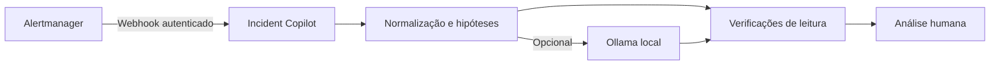

# Incident Copilot Lab

Em um incidente, o primeiro desafio nem sempre é corrigir o serviço. Muitas vezes é separar o que o alerta **mostra** do que ainda é só hipótese. Criei este laboratório para receber uma notificação do Alertmanager, organizar os sinais e devolver um roteiro curto de investigação. Ele funciona sem API paga. Se houver um Ollama rodando localmente, posso pedir uma segunda leitura ao modelo, claramente identificada como sugestão não verificada.

Este projeto foi inspirado na ideia de *AI-assisted DevOps* apresentada neste [vídeo da Vishakha Sadhwani](https://www.youtube.com/watch?v=X6Kw2_wZr1E). A implementação e as decisões operacionais deste repositório são próprias. Os dados de incidente são sintéticos; não publico logs ou configurações da empresa onde trabalho.

## Fluxo



O serviço aceita o formato de webhook do Alertmanager, limita o corpo a 64 KiB e até 20 alertas, exige um Bearer token e inclui somente campos necessários na resposta. Há uma sanitização básica de padrões de segredo e validação dos nomes usados em sugestões de comandos. Ele **não** consulta o cluster, não executa comandos, não reinicia pods e não toma decisões de remediação. O texto gerado por IA é tratado como hipótese. Para dados reais, ainda é preciso revisar as políticas da organização, controle de acesso, retenção e a necessidade de um proxy com TLS.

## Experimentar sem infraestrutura

Precisa apenas de Python 3.12 ou superior. Não há dependências externas de Python.

```bash
python -m incident_copilot.cli analyze fixtures/oom-alert.json
python -m incident_copilot.cli analyze fixtures/oom-alert.json --json
python -m unittest discover -s tests -v
```

O exemplo simula reinícios por memória em um serviço. A resposta propõe conferir impacto, eventos, logs e métricas antes de qualquer alteração. O relatório também mostra que uma causa raiz não pode ser afirmada apenas pelo alerta.

## Receber um webhook

Gere um token para o seu ambiente e mantenha-o fora do Git:

```bash
export INCIDENT_COPILOT_TOKEN="$(python -c 'import secrets; print(secrets.token_urlsafe(32))')"
python -m incident_copilot.cli serve
```

Em outro terminal, envie o exemplo usando o mesmo token no ambiente desse terminal:

```bash
curl -fsS http://127.0.0.1:8080/healthz
curl -fsS -X POST http://127.0.0.1:8080/webhook/alertmanager \
  -H 'Content-Type: application/json' \
  -H "Authorization: Bearer ${INCIDENT_COPILOT_TOKEN}" \
  --data-binary @fixtures/oom-alert.json
```

O arquivo [`examples/alertmanager.yml`](examples/alertmanager.yml) mostra a configuração do receiver com `credentials_file`. O valor desse arquivo precisa coincidir com `INCIDENT_COPILOT_TOKEN`. A URL do exemplo usa o nome de serviço de uma rede de containers; ajuste conforme sua topologia. Em um ambiente compartilhado, coloque o serviço atrás de TLS e limite a origem das requisições. Não use o token de demonstração do pipeline.

Para container local:

```bash
docker build -t incident-copilot:local .
docker run --rm -p 127.0.0.1:8080:8080 \
  -e INCIDENT_COPILOT_TOKEN="$INCIDENT_COPILOT_TOKEN" incident-copilot:local
```

## IA local opcional

Com [Ollama](https://docs.ollama.com/api/generate) instalado e o modelo `gemma3:1b` disponível no próprio computador:

```bash
python -m incident_copilot.cli analyze fixtures/oom-alert.json --ollama
```

O acesso é feito ao endpoint local `http://127.0.0.1:11434/api/generate`. Se o modelo estiver indisponível, a análise por regras continua funcionando e o relatório informa a falha. A opção `--ollama` no servidor é apropriada quando servidor e Ollama rodam na mesma máquina; em containers, `127.0.0.1` aponta para o próprio container, então é preciso adaptar a integração e a rede antes de usar. Mesmo após a sanitização, uma descrição de alerta pode conter informação sensível não reconhecida; use o modelo somente em um ambiente autorizado.

## Como validei

O GitHub Actions executa testes de análise e sanitização, o comando de linha, build Docker e um teste HTTP real: rejeita requisição sem token e processa um alerta autenticado. O teste usa dados sintéticos e um token exclusivo do CI. A integração ponta a ponta com um Alertmanager externo e o resultado de um modelo Ollama não são afirmados como validados por esse pipeline; as instruções acima permitem reproduzir essas etapas em homologação.

## Onde eu evoluiria

- Correlacionar métricas e logs por janela temporal, com conectores de leitura e controles de acesso.
- Registrar feedback do analista para avaliar a utilidade das hipóteses e reduzir falsos caminhos.
- Adicionar persistência, idempotência e fila para volume maior de alertas; esta versão responde de forma síncrona e não guarda histórico.
- Criar testes de prompt injection e regras de redaction ajustadas à classificação de dados do ambiente.

O projeto conversa com o meu [laboratório de observabilidade](https://github.com/Glaucojr17/sre-observability-incident-lab) e com o [kube-triage](https://github.com/Glaucojr17/kube-triage): um alerta aciona a investigação, a ferramenta organiza as hipóteses e o operador verifica o cluster antes de agir.

### Referências

- [Formato do webhook do Alertmanager](https://prometheus.io/docs/alerting/latest/configuration/#webhook_config)
- [API de geração do Ollama](https://docs.ollama.com/api/generate)

